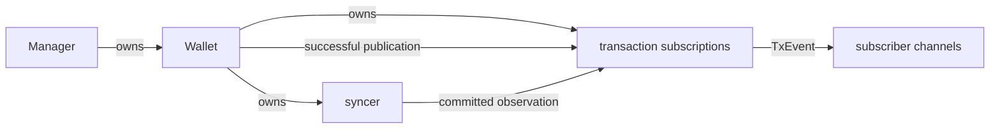

# ADR 0016: Wallet Transaction Subscriptions

## Status

- **Status:** Proposed
- **Date:** 2026-10-17

## Relationships

- **Amends:** None.
- **Supersedes:** None.
- **Amended by:** None.
- **Superseded by:** None.

## 1. Problem

Wallet clients need confirmed and unconfirmed transaction events without slow
subscribers blocking transaction operations or changing their results.

## 2. Context

`Manager` owns Wallet lifecycle. `Wallet` implements `TxReader`, `TxWriter`,
and `TxPublisher`; its syncer records chain observations. `TxDetail` already
provides the wallet-relative transaction data clients need.

### Constraints

- Apply the same contract to kvdb, SQLite, and PostgreSQL.
- Preserve persistence, publication, rollback, and shutdown ownership.
- Delivery is best effort, with no replay or transaction-ordering guarantee.

## 3. Decision

Each Wallet owns private transaction subscriptions. Successful publication
and committed syncer writes invoke their notification interface. Preparation
failure skips the event without changing the operation's result.

`Wallet` implements `TxSubscriber`; `SubscribeTxns` returns an event channel
and cancellation function.
Explicit cancellation discards queued events and closes the channel before
returning. Caller-context completion and Wallet shutdown also end the stream.
Use existing Wallet request admission and shutdown to own these lifetimes.

Prepare each `TxEvent` once from committed `TxDetail` and observation time,
then copy mutable data per subscriber. Block information distinguishes
confirmed and unconfirmed events. Each channel retains at most 1,000 events;
overflow discards the oldest and keeps the incoming event without ending the
subscription. Retained events are FIFO, and sends never wait for consumers.

One mutex coordinates membership, sends, and closure. Database reads and detail
conversion remain outside it. Late registration can miss events; callers should
subscribe before initiating work.

## 4. Rationale

A private notification owner gives syncer only the dependency it needs. Shared
transaction-detail conversion avoids backend-specific payloads. One map and
mutex safely coordinate channels without a delivery worker or transaction
tracking. Cancellation reuses Wallet's existing request loop.

## 5. Alternatives Considered

### Alternative: Transaction coordinator

Ordering and publication tracking add transaction-state responsibilities that
best-effort observations do not require.

### Alternative: Store wrapper

A persistence wrapper would couple notifications to every Store operation and
still need wallet-relative conversion. Existing producer boundaries suffice.

### Alternative: Main-loop delivery

Direct delivery avoids another inbox and overflow policy for producer events.
The existing request loop remains responsible for explicit cancellation.

### Alternative: Concurrent map

`sync.Map` protects membership but cannot coordinate channel sends with closure.
A normal map keeps those operations under one synchronization boundary.

## 6. Consequences

### Positive

Wallet owns subscriber lifetime. Slow consumers and preparation failures do not
change transaction results; syncer has no new dependency on its parent Wallet.

### Negative and Risks

Events may be lost, repeated, or delivered out of transaction order. There is no
snapshot, replay, all-status feed, or complete reorg history; query Wallet for
current state. Subscriber count is uncapped, so total memory and fan-out work
grow despite bounded individual queues. Explicit cancellation may wait for
other Wallet control requests.

Incoming unconfirmed events depend on the chain backend's mempool feed, which
Neutrino does not provide. Local publication and confirmed chain observations
remain available across all supported backends.

## 7. Implementation Overview

Reuse the committed transaction-detail mapper and publication/syncer hooks.
The private owner holds subscription state and immutable read dependencies.
Database schemas, chain coordination, and lnd/RPC changes remain out of scope.

Verify wallet isolation, confirmed/unconfirmed payloads, drop-oldest FIFO,
cancellation/shutdown races, and preservation of operation results.

## 8. References

- [Engineering Guide](../ENGINEERING_GUIDE.md)
- [ADR 0015](0015-sql-shared-chain-ownership.md)
