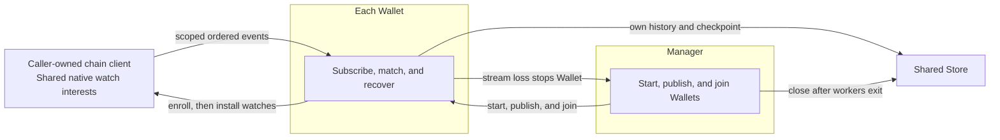

# ADR 0017: Direct Wallet Chain Subscriptions

## Status

- **Status:** Accepted
- **Date:** 2026-11-27

## Relationships

- **Amends:** [ADR 0006](0006-wtxmgr-sql-schema.md) for Wallet-owned block
  identity and references, and [ADR 0015](0015-sql-shared-chain-ownership.md)
  for direct Wallet subscriptions, synchronous watch installation before
  publication, and Wallet-owned history and rollback.
- **Supersedes:** None.
- **Amended by:** None.
- **Superseded by:** None.

## 1. Problem

Wallets need ordered chain events to advance separate checkpoints and recover
independently. Installing a watch can produce an immediate observation, so each
Wallet needs an active subscription before its persisted watches take effect.

## 2. Context

The caller owns one chain client and its connection. Previously, Manager read
the shared legacy notification stream, matched events in a shared chain syncer,
and forwarded work to Wallets. Manager retains aggregate lifecycle, Wallet
membership, and Store ownership, while each Wallet owns its own event
subscription, tx processing, checkpoint, and historical recovery.

### Constraints

- The caller owns the chain client's lifetime and any legacy notification
  drain.
- Each Wallet receives events in source order and enrolls in its subscription
  before installing watches.
- Both SQL and KVDB Wallets install persisted watches synchronously before
  Manager publishes them when the chain backend is current, and defer watch
  installation until the backend catches up during initial sync.

## 3. Decision

The chain client supplies a separate ordered event stream to each Wallet and
shares native address and outpoint watch interests across subscriptions. Each
managed Wallet enrolls its subscription during construction. When the chain
backend is already current, the Wallet installs persisted address and outpoint
watches synchronously before background workers start and before publication.
When the backend is still catching up, watch installation is deferred until
backend sync finishes so historical catch-up blocks do not overflow the bounded
live event buffer. This policy applies uniformly across SQL and KVDB backends.

Manager starts, publishes, and joins Wallets, and never reads the shared legacy
notification stream. Callers that still consume the legacy stream remain its
sole drain owner. Historical catch-up proceeds independently of publication. If
a Wallet's subscription closes or overflows during synchronous watch setup or
while sibling candidates are starting, startup or creation rejects publication
and closes owned resources. After publication, if a single Wallet's
subscription closes or overflows, that Wallet logs the terminal stream error
and stops itself through Manager without disrupting healthy sibling Wallets. On
Manager shutdown, Manager stops and joins all Wallet workers before closing
Store. The chain client stays with its caller.

During pre-sync retry backoff, empty connected blocks drain without Store
writes, and transient event write failures log and continue. Unconfirmed
mempool conflicts rely on confirmed blocks as authoritative, and transient
pre-commit write failures on supplemental pre-sync blocks follow the same
log-and-continue policy as steady-state event processing. Durable recovery for
failed supplemental block writes is deferred to a separate follow-up.

SQL block observations are keyed by Wallet and height. Confirmation, birthday,
and checkpoint references carry the same Wallet identity. The Wallet worker
verifies exact height and hash equality during catch-up, verifies parent hash
continuity before advancing its checkpoint on live blocks, and atomically
rewinds its own history on disconnect. It clears affected confirmations and
orphans disconnected coinbases before deleting their block rows, then discards
stale fetched work. Canonical observations below the disconnect remain valid
even when the saved checkpoint lags.

## 4. Rationale

Direct subscriptions keep enrollment, watch registration, and overflow
isolation with the Wallet that owns the watches, while the chain client shares
native backend subscriptions and filters txns per subscriber. Local history
lets Wallets progress at different heights and limits each rewind to one
Wallet. Manager keeps aggregate lifecycle and Store ownership.

## 5. Alternatives Considered

### Keep Manager as the single reader

Native notifications arrive on one channel. Multiple readers would compete
for events. Manager reads the channel once and forwards work to bounded
Wallet inboxes. This preserves source order and avoids repeated matching,
but a full inbox can stall forwarding for sibling Wallets.

### Shared history with Manager-wide reconciliation

A shared history required aggregate coordination to rewind independently
advancing Wallets. Wallet-owned history removes that coordination at the cost
of duplicating block metadata. Each Wallet still needs local fork detection.

### Shared block tree keyed by hash

A shared table can retain competing blocks at the same height while
each Wallet rewinds its own references. A Wallet can observe a block
before its parent is known or before its checkpoint reaches that
height. The tree would still need Wallet-local observations to recover
that history. Those rows and indexes reduce the storage savings, and
reading block metadata from them adds a join.

## 6. Consequences

### Positive

- Each Wallet subscribes, receives scoped events, and recovers independently.
  A rewind or subscription buffer overflow affects only that Wallet.
- When the chain backend is current, persisted watches are installed
  synchronously before publication across both SQL and KVDB backends, closing
  the startup watch-registration window. During backend catch-up, registration
  is deferred so initial block download cannot overflow the live event buffer.

### Negative and Risks

- A slow Wallet whose bounded subscription buffer overflows is disconnected
  and stopped rather than applying backpressure to sibling Wallets, including
  if the buffer fills during synchronous watch setup before publication.
- Storage grows with the sum of the Wallets' retained block histories.
  Wallets retaining the same range each store its block metadata and
  indexes. Recovery of retained orphan observations above a canonical
  checkpoint remains a separate concern.

## 7. Implementation Overview

The [SQL schema](0006-wtxmgr-sql-schema.md#24-implementation-overview)
stores Wallet-owned block history, and each Wallet consumes its own
lifetime-scoped chain event stream. Persisted watches are installed
synchronously before publication across SQL and KVDB whenever the chain backend
is current (and deferred during backend catch-up), and live tip advancement
verifies parent hash continuity before committing.

## 8. References

- [ADR 0015: Manager lifecycle and SQL shared-chain
  ownership](0015-sql-shared-chain-ownership.md).
- [ADR 0006: SQL schema](0006-wtxmgr-sql-schema.md).
- [ADR 0004: Targeted recovery](0004-targeted-rescan-vs-rewind.md).
